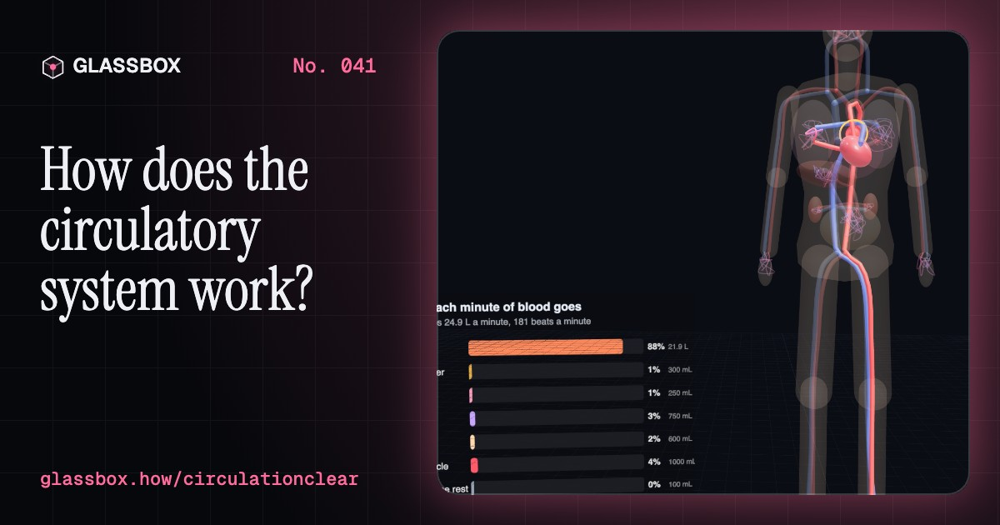
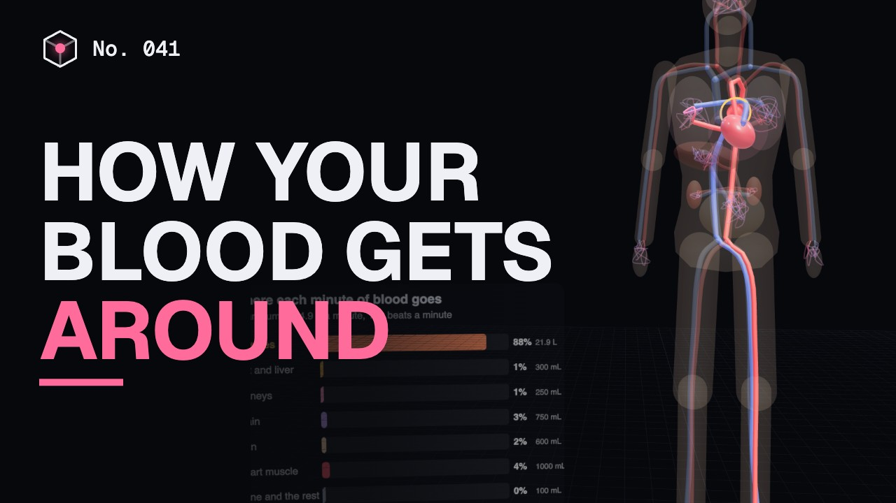
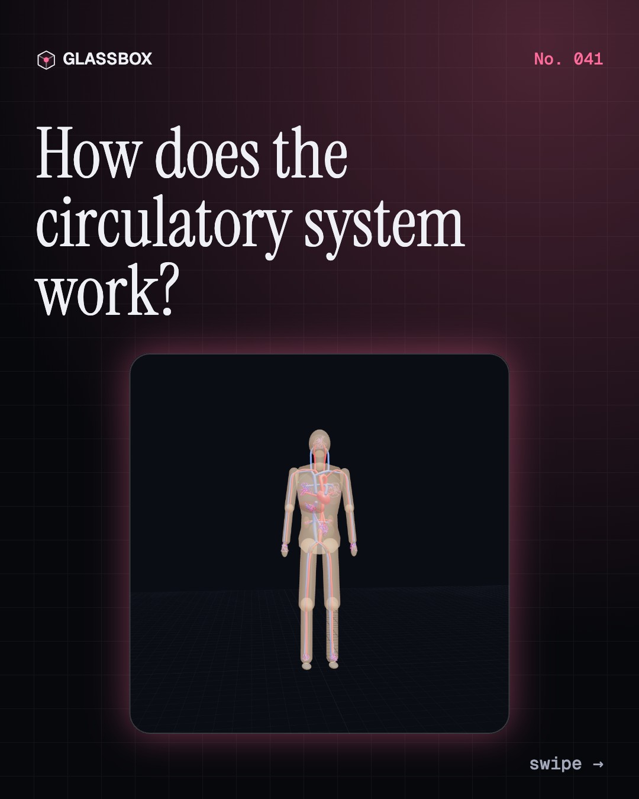
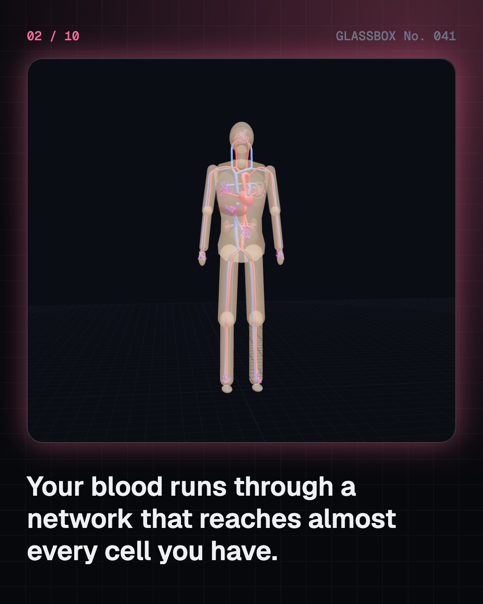
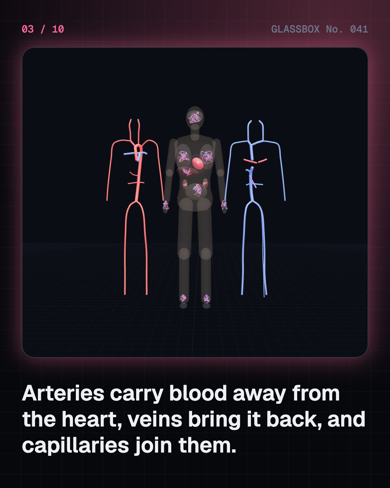
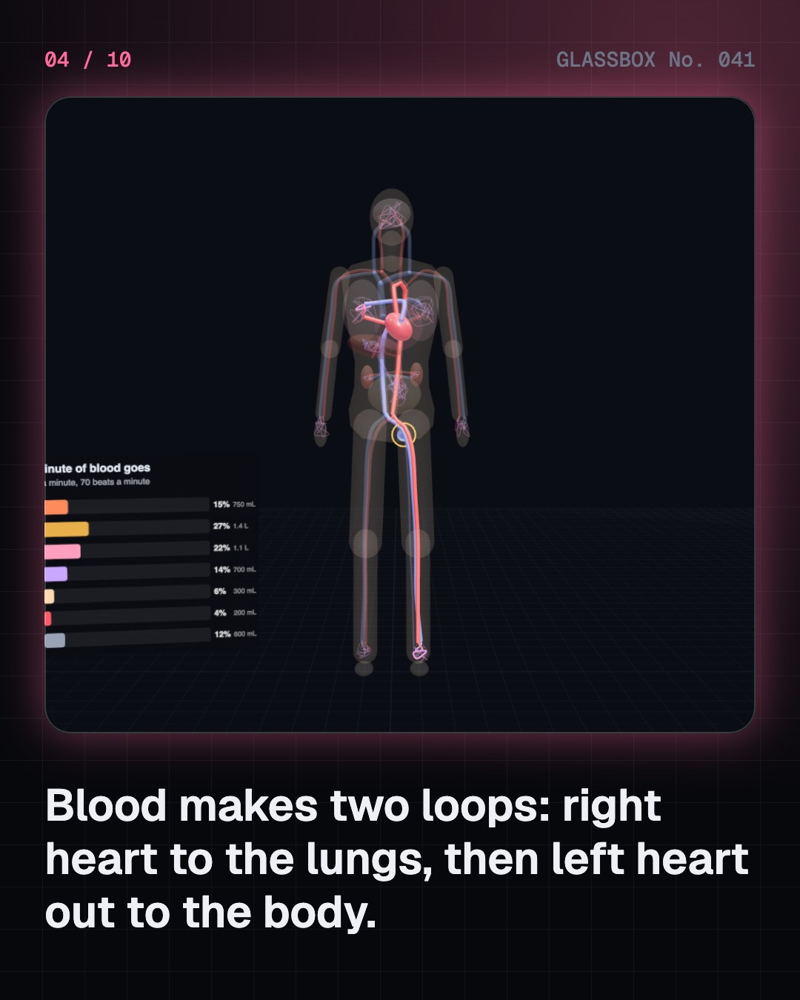

<!-- glassbox:start -->
<!-- Generated from glassbox.json by the Glassbox hub (npm run readme -- circulationclear). Edit glassbox.json, not this block. -->
<p align="center"><a href="https://glassbox-production-fd52.up.railway.app/e/circulationclear/"></a></p>

<h1 align="center">CirculationClear</h1>

<p align="center"><b>How does the circulatory system work?</b><br>Five litres of blood go round your body about once a minute, through a network that reaches almost every cell. Follow one red blood cell to the lungs and back, squeeze an arteriole and watch the flow collapse, see what leaks out of a capillary, and plug a cut.</p>

<p align="center"><a href="https://glassbox-production-fd52.up.railway.app/circulationclear/"><b>▶ Play with it</b></a> &nbsp;·&nbsp; <a href="https://glassbox-production-fd52.up.railway.app/e/circulationclear/">Read the 60-second explainer</a> &nbsp;·&nbsp; <a href="https://glassbox-production-fd52.up.railway.app/circulationclear/glassbox/reel.mp4">Watch the 40-second video</a></p>

<p align="center">
  <a href="https://glassbox-production-fd52.up.railway.app/e/circulationclear/"></a>
  <a href="https://glassbox-production-fd52.up.railway.app/e/circulationclear/"></a>
  <a href="LICENSE"></a>
  <a href="LICENSE-CONTENT.md"></a>
  <a href="#privacy"></a>
</p>

## In 60 seconds

1. **A network in every part of you.** Arteries carry blood away from the heart, veins bring it back, and about 10 billion capillaries join them in every organ. The portal vein sends gut blood to the liver first, and faint lymph vessels return fluid that leaks out.
2. **Two loops, one lap a minute.** Right heart to the lungs and back, then left heart to the body and back: a double circulation. About 5 L of blood pumped at about 5 L a minute means a lap takes about a minute, 98% full of oxygen out and about 75% back. In a sprint the heart pumps four or five times more, and most of it floods the muscles.
3. **From 120 over 80 to almost nothing.** Pressure falls from about 120/80 in the aorta to about 35 then 15 mmHg across the capillaries. The biggest drop is in the muscular arterioles, and by Poiseuille's law halving their radius cuts flow sixteen-fold. Baroreceptors and the kidneys keep the pressure steady.
4. **Swap at the capillaries.** Oxygen and glucose diffuse out, carbon dioxide diffuses in. Blood pressure pushes fluid out, plasma proteins pull it back, and the lymph takes the extra. Veins have one-way valves, and the calf muscle pump drops ankle vein pressure from about 90 to about 20 mmHg when you walk.
5. **What blood is.** About 55% plasma and 40–45% red cells, with white cells and platelets in a thin layer. A cut makes the vessel narrow, platelets plug it, and a cascade of clotting proteins ends in fibrin threads that make a firm clot.
6. **Keeping it healthy.** High blood pressure affects about 1 in 4 adults in India and usually has no symptoms. Plaque narrows arteries; a clot on it causes a heart attack or stroke (call 112 or 108). Varicose veins, anaemia and giving blood too. For your own health, see a doctor.

## Words worth knowing

| Term | Meaning |
|---|---|
| **Double circulation** | Blood passes through the heart twice per lap: once for the lungs, once for the body. |
| **Artery and vein** | Arteries carry blood away from the heart; veins carry it back. Direction, not colour, decides. |
| **Capillary** | The tiniest vessel, about one red cell wide, where oxygen, food and waste are swapped. |
| **Arteriole** | The smallest artery, with a muscle ring that acts like a tap on the blood supply. |
| **Poiseuille's law** | Flow through a narrow tube depends on its radius to the fourth power. |
| **Starling forces** | Blood pressure pushing fluid out of capillaries and plasma proteins pulling it back in. |
| **Baroreceptor** | A stretch sensor in the neck and aorta that helps the brain keep blood pressure steady. |
| **Haematocrit** | The share of blood made of red cells, about 40–45%. |
| **Clotting cascade** | A chain of blood proteins, each switching on many of the next, that ends in fibrin threads. |

## A short history

**From Galen's one-way blood to blood banks, cuffs and clot science: 1,800 years of finding the loop.**

- **1242** · Blood goes through the lungs (Ibn al-Nafis, Cairo, Egypt)
- **1628** · Blood goes round and round (William Harvey, London, England (printed in Frankfurt))
- **1661** · The missing link: capillaries (Marcello Malpighi, Bologna, Italy)
- **1733** · Blood pressure, measured on a horse (Stephen Hales, Teddington, England)
- **1840** · Narrow tubes and the fourth power (Jean Léonard Marie Poiseuille, Paris, France)
- **1896** · The push and pull at the capillaries (Ernest Starling, University College London, England)
- **1901** · Blood comes in groups (Karl Landsteiner, Vienna, Austria)
- **1942** · India's first blood bank (All India Institute of Hygiene and Public Health, Kolkata (Calcutta), India)

The full story, with 29 moments, charts, people and 53 sources: [glassbox.how/e/circulationclear/history](https://glassbox-production-fd52.up.railway.app/e/circulationclear/history/). The data lives in [`history.json`](history.json).

## Video and slides

Made with the Glassbox studio from this box's storyboard (`window.glassbox.director`). Free to reuse under CC BY 4.0.

<a href="https://glassbox-production-fd52.up.railway.app/circulationclear/glassbox/video.mp4"></a>

<p><a href="glassbox/slide-1.jpg"></a> <a href="glassbox/slide-2.jpg"></a> <a href="glassbox/slide-3.jpg"></a> <a href="glassbox/slide-4.jpg"></a></p>

| File | What | Size |
|---|---|---|
| [`glassbox/reel.mp4`](https://glassbox-production-fd52.up.railway.app/circulationclear/glassbox/reel.mp4) | Reel / Short, with captions and soundtrack | 1080×1920 |
| [`glassbox/video.mp4`](https://glassbox-production-fd52.up.railway.app/circulationclear/glassbox/video.mp4) | YouTube video, with captions and soundtrack | 1920×1080 |
| `glassbox/slide-1…10.jpg` | Instagram carousel | 1080×1350 |
| `glassbox/thumb.jpg` | YouTube thumbnail | 1280×720 |
| `glassbox/cover.jpg` | Share card and repo social preview | 1200×630 |
| [`glassbox/history-reel.mp4`](https://glassbox-production-fd52.up.railway.app/circulationclear/glassbox/history-reel.mp4) | “History in 10 moments” Reel / Short | 1080×1920 |
| `glassbox/history-slide-*.jpg` | History carousel | 1080×1350 |
| `glassbox/post.json` | Post copy and schedule used by the publish kit | |

## Privacy

This box has no accounts and no ads, and it ships its own fonts and libraries. When you run it yourself it sends nothing anywhere. On glassbox.how, the site's `/bar.js` also loads Glassbox's analytics: **Google Analytics** to count visits (it asks first in the EU, UK and Switzerland, and stays off when your browser sends Global Privacy Control or Do Not Track) and **ClickTrust** to detect bots.

It remembers a few things **in your own browser only**, and never sends them anywhere:

| Browser storage key | What it holds |
|---|---|
| `circulationclear.v1` | Which chapters you have opened, your best quiz scores, and sound on or off. |

Exactly what each one sees is at [glassbox.how/privacy](https://glassbox-production-fd52.up.railway.app/privacy/).

## Licences

- **Code:** [MIT](LICENSE). Use it, change it, ship it.
- **Explanations, text, images and videos** (`glassbox.json`, `glassbox/`): [CC BY 4.0](LICENSE-CONTENT.md). Credit “Glassbox, glassbox.how/e/circulationclear”.
- **Third-party parts** keep their own licences: [three.js](https://threejs.org) (MIT), [Geist, Instrument Serif](https://openfontlicense.org) (SIL OFL 1.1).
- The Glassbox name and logo aren't covered by either licence. See the [terms](https://glassbox-production-fd52.up.railway.app/terms/).

Found a mistake? [Open an issue](https://github.com/bdeeps/circulationclear/issues). Corrections happen in public.
<!-- glassbox:end -->

## Run it

It's plain HTML, CSS and JavaScript. No build step and no dependencies. Run locally, it contacts no other website.

```bash
python3 -m http.server 8000
```

Three.js and the fonts ship in `vendor/` and `fonts/`, so it also works offline.

Then open http://localhost:8000.

## How it's built

| File | What |
|---|---|
| `index.html`, `css/app.css` | The page and its styles |
| `js/app.js`, `js/stage.js`, `js/ui.js`, `js/kit.js` | The shared Glassbox 3D engine: chapters, 3D stage, controls, quiz, video director |
| `js/chapters/*.js` | One file per chapter: the 3D model, controls, text, key terms, quiz and video scenes |
| `js/circ.js` | The ghosted body with the whole vascular tree (arteries, veins, pulmonary and portal vessels, capillary beds, lymph), shared physiology numbers (organ blood flows, oxygen saturations, Fick's principle) and helpers |
| `glassbox.json` | Title, question, explainer beats, key terms, browser storage and credits shown on glassbox.how |
| `reel` in each chapter | The storyboard the Glassbox studio records into short videos |
| `glassbox/` | The published video, slides, thumbnail and post copy |
| `fonts/`, `vendor/three/` | Self-hosted Geist and Instrument Serif (SIL OFL 1.1) and three.js (MIT) |
